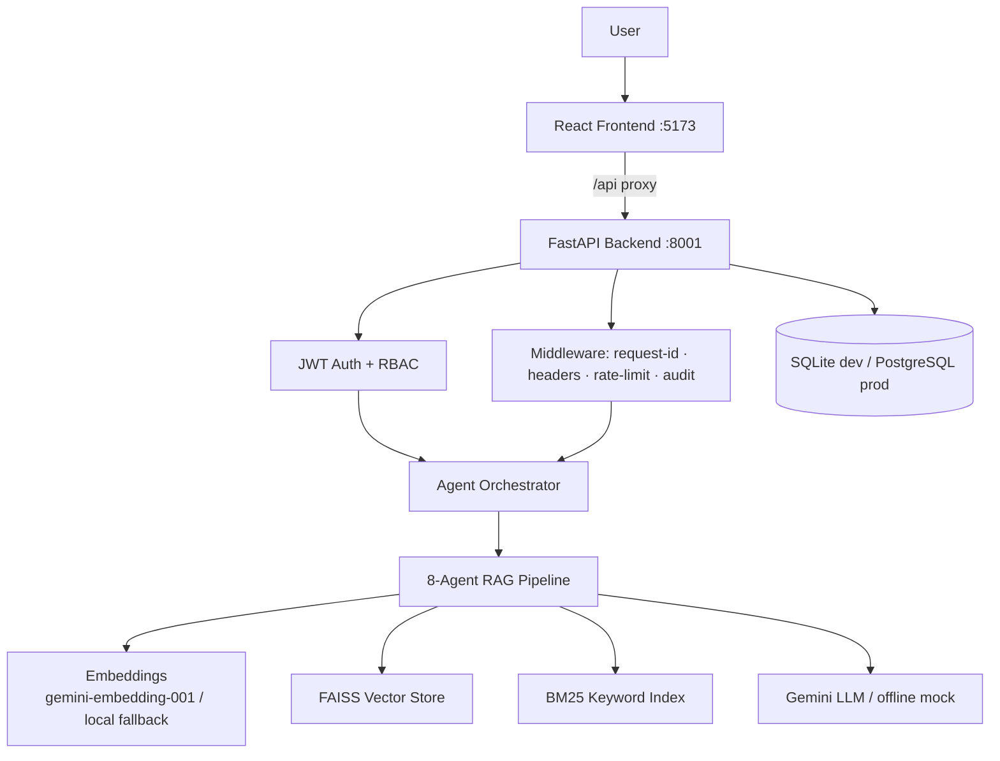
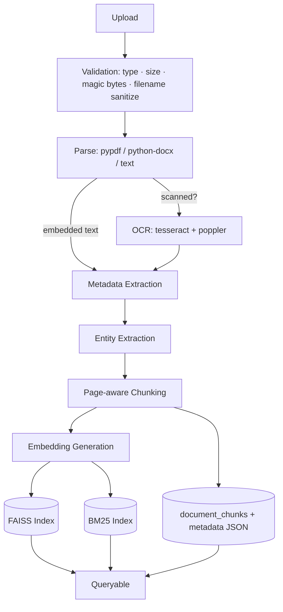
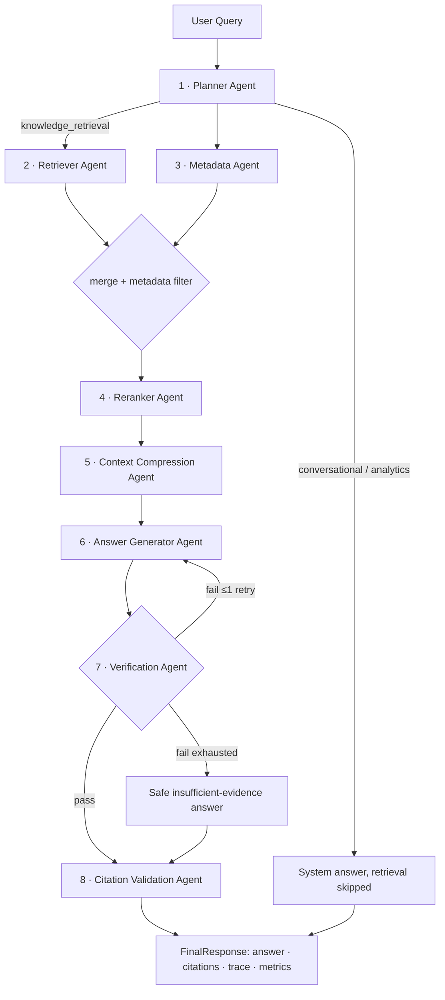
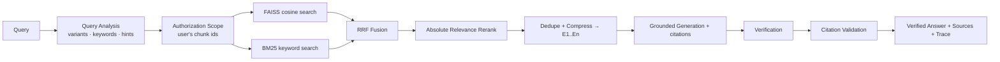
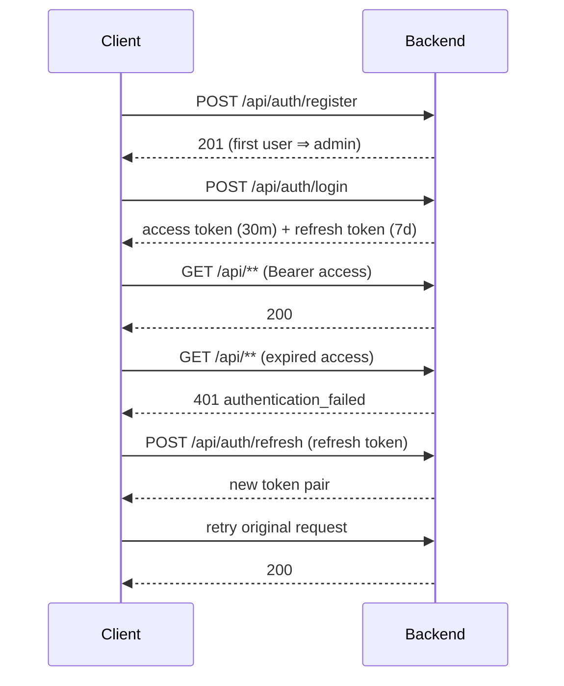
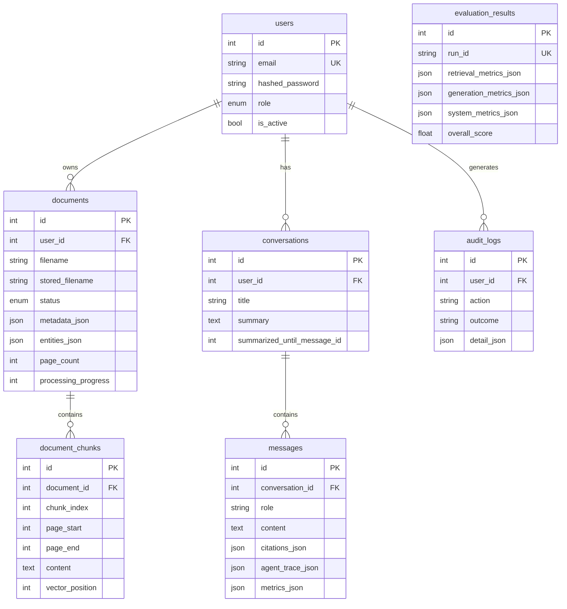
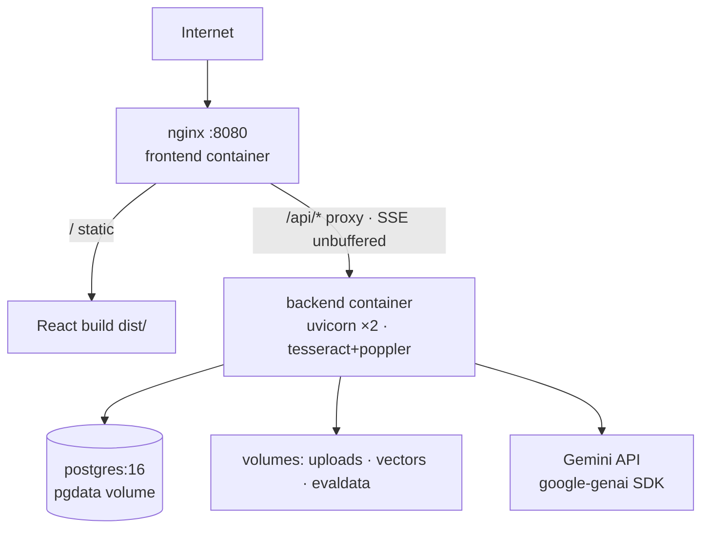

# KnowledgeIQ — Diagram sources (Mermaid)

Renderable sources for the seven architecture diagrams (ASCII versions live in `ARCHITECTURE.md`).

## 1. High-level architecture

## 2. Document ingestion

## 3. Multi-agent workflow

## 4. RAG data flow (query)

## 5. Authentication flow

## 6. Database / ER

## 7. Deployment

